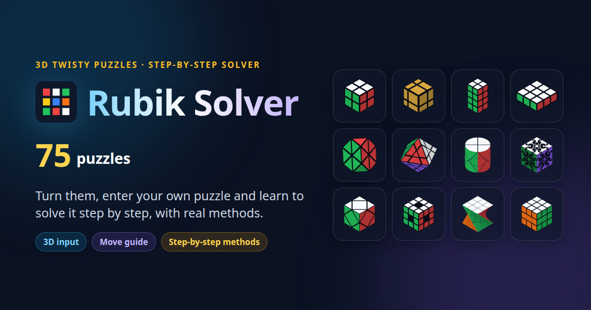
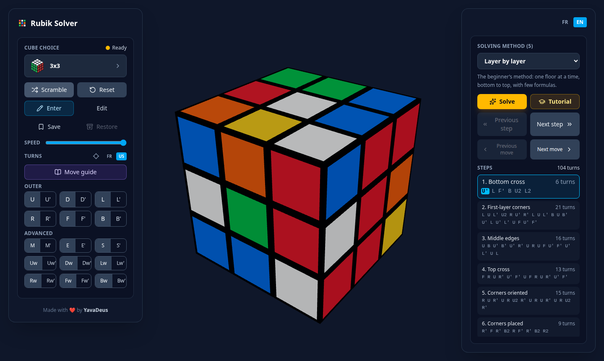
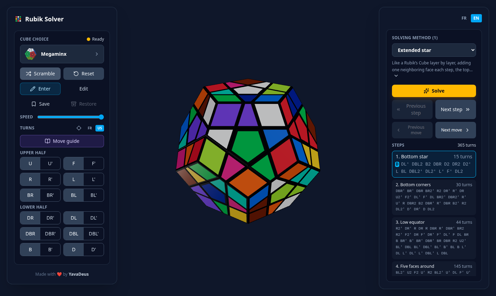
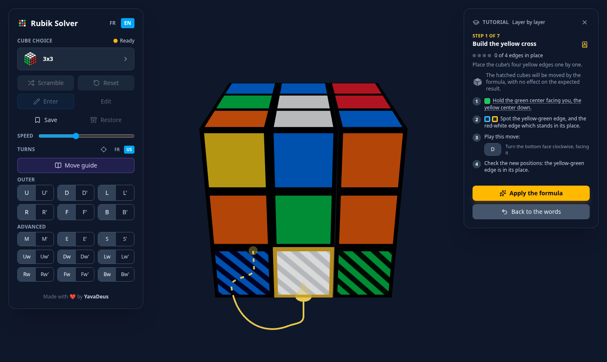
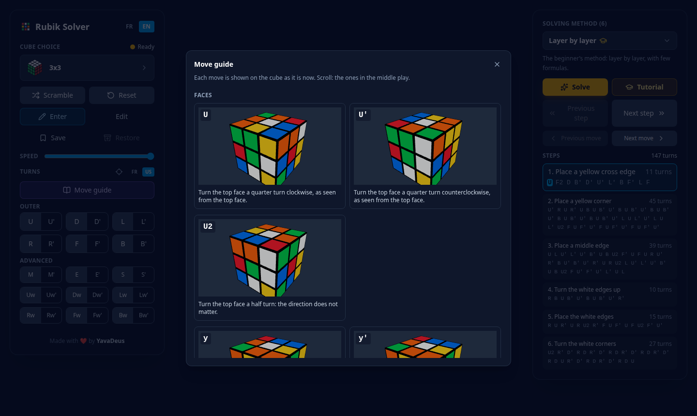
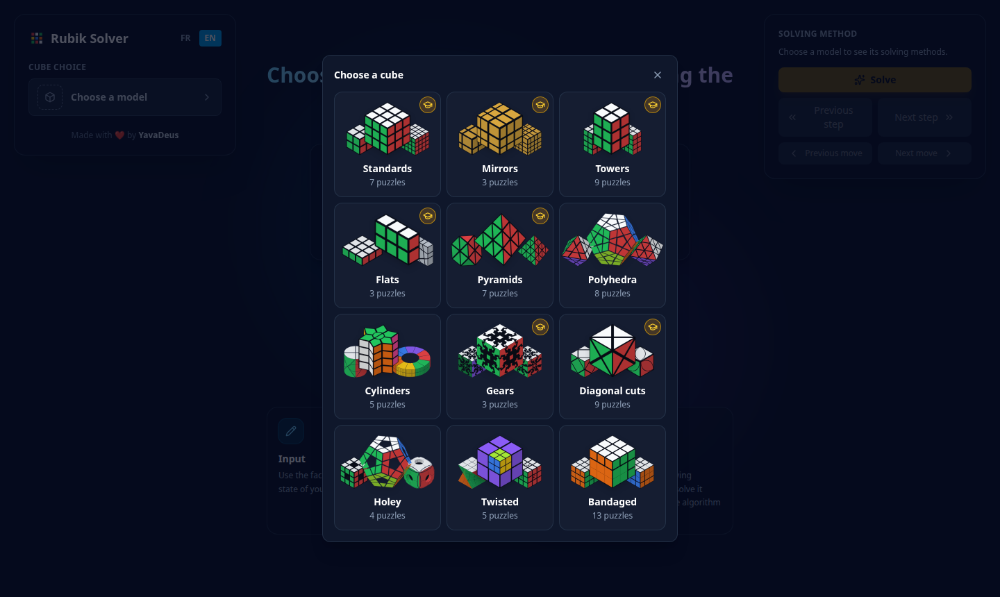

<div align="center">


# Rubik Solver

**Turn, scramble or enter 75 twisty puzzles in 3D, then solve them step by step with
real methods, or learn to solve the 3x3, the 2x2, the 4x4, the 5x5, the super cubes, the Floppy, the 1x2x3, the Floppy Ghost, the Pyraminx, the Pyramorphinx, the Skewb, the Gear Cube Ultimate or the 2x2x4 tower yourself with a guided tutorial.**

[**Try it**](https://rubiksolver.yavadeus.dev) &nbsp;·&nbsp;
[The puzzles](#75-puzzles-12-families) &nbsp;·&nbsp;
[How it works](#how-it-works) &nbsp;·&nbsp;
[Technical docs](AGENTS.md)

<a href="https://rubiksolver.yavadeus.dev">
  
</a>

<sub>
  100% front-end &nbsp;·&nbsp; React 19 + React Three Fiber &nbsp;·&nbsp; TypeScript strict &nbsp;·&nbsp;
  integer-only puzzle engine &nbsp;·&nbsp; 48 solving methods &nbsp;·&nbsp; 15 guided tutorials &nbsp;·&nbsp;
  French and English &nbsp;·&nbsp; MIT license
</sub>

</div>

---

## What you can do

### Solve it, one named step at a time

Pick a puzzle, scramble it, and choose a method. The solution is computed in the
background as soon as the puzzle is at rest, and split into the **steps of the
method**: play it all at once, step by step or move by move, forward and backward,
with the current move highlighted in its sequence. Keyboard too: Enter, Space, Page
Up / Page Down and the arrows.



On the 3x3 alone: **layer by layer, Ofapel, cross then corners, CFOP, Roux, Petrus and ZZ**. The 4x4, 5x5 and 6x6
are solved by **reduction** (centers, edge pairing, parity, then as a 3x3), small
puzzles also get an **optimal** solution, and every other puzzle has a method of its
own.



### Learn how to solve it with a step-by-step tutorial

On the 3x3, the **tutorial** walks you through the beginner's method, seven stages
from the yellow cross to the last corners, one piece at a time. Each step tells you
which center to hold in front, which piece to move and where to (an arrow shows the
way, the pieces in play shine), and the formula to play, its moves explained in words
while the letters are new. Play it with a button, or by hand on the move pad: the
tutorial follows your moves, adapts when you stray, and can take you back to where the
step began. Pick another piece if you like, and the formula changes with it. The 3x3 has
a second one, Ofapel's method from francocube: the first face, then the top corners before
the edges, the cube tipped on its side to end in the middle slice; and a third, cross then
corners: every edge, then every corner, each step with a single formula, the cube turned in
hand to bring its pieces where the formula takes them. The 2x2 has its own, the
four steps and three formulas of its maker's manual: the yellow face built on top, its
corners placed, then the cube turned over for the white face and its corners.
The Pyraminx has one too, laid flat, in five stages from the centers to the flipped edges, and
the Pyramorphinx, solved as the 2x2 it hides. The Skewb follows francocube's method: the top
corners by turns of the bottom ones, then one four-move formula for the centers and, played twice,
the bottom corners. The Gear Cube Ultimate places its corners, then its edges, their clips and
their gears, each by one of the page's formulas. The 2x2x4 tower is back in shape bar by bar, then
solved as two Pockets stacked, the inner one then the outer one. The 4x4 gathers its centers and pairs its edges, then
plays the 3x3's stages on the reduced cube, its two parities fixed where they show. The 5x5
does the same around its fixed centers, its edges completed a wing at a time the way cubers do.
The super cubes play those on their colors, then cycle their centers home three at a time.
The Floppy and the 1x2x3 place their corners in a few half turns, then flip their edges by one formula.
The all-silver Floppy Ghost names its pieces in a legend, each pictured front and back.
Every tutorial starts with its words (an edge, a tip, clockwise...), shown on the puzzle.



### Learn how it moves

The **move guide** plays every move of the puzzle on the puzzle as it is now, with its
notation and a sentence describing it. A move the current shape blocks is shown as
such. Notation is international (U D L R F B) or French (H B G D F Ar).



### Enter your own puzzle

Paint the stickers of your physical puzzle on the 3D model. The input is **guided**:
pieces complete themselves, and no impossible piece or color count can be entered;
solvability is then checked. A puzzle that changes shape is entered in the shape it is
in, picked among thumbnails, and a few are entered piece by piece.

#### Or show it to the camera

On a phone or a laptop, **scan** the puzzle instead: show it face by face, as the
instructions say (where to turn it, with an arrow), and each face is taken on its own
once it is still in the frame. The whole puzzle is then read at once, its colors
matched to real pieces, and painted in the editor, to check and correct before
validating. 26 of the 75 puzzles scan: the cubes from 2x2 to 6x6 and the cuboids, the
Megaminx, the diagonal cubes (Skewb, Dino, Rex...), the 2x2x4 and 2x3x4 towers, whose
shape the scan finds by itself, the all-silver Floppy Ghost, read from one picture by
the outlines of its pieces, and the 3x3 mirror, read by the sizes of its stickers.
Everything stays in the browser: no picture leaves the device.

### And also

A link per puzzle and language to share (`#/en/megaminx`), a saved state to compare
two methods on the same scramble, mirror versions of the 2x2, 3x3 and 4x4, a mobile
layout, and fireworks when a move solves the puzzle.

## 75 puzzles, 12 families



| Family            | Puzzles                                                                                                                          |
| ----------------- | -------------------------------------------------------------------------------------------------------------------------------- |
| **Standard**      | 2x2 (Pocket), 3x3, 4x4 (Revenge), 5x5 (Professor), 6x6, Super Revenge, Super Professor                                           |
| **Mirror**        | the 2x2, 3x3 and 4x4 as Mirror Blocks, solved by shape                                                                           |
| **Towers**        | 2x2x3, 2x2x4, 2x3x4, Domino 3x3x2, 3x3x4, 4x4x3, 4x4x5, 5x5x4, Camouflage 4x4x2                                                  |
| **Flat**          | 1x2x3, Floppy 3x3x1, Floppy Ghost                                                                                                |
| **Pyramids**      | Pyraminx, Tetraminx, Master and Professor Pyraminx, Pyraminx Jing, Pyramorphinx, Master Morphinx                                 |
| **Polyhedra**     | Megaminx, Pyraminx Crystal, FTO, 4-Trajber's Octahedron, Octahedron VTO, GEM-0, Rainbow, Skewb Ultimate                          |
| **Cylinders**     | 2-Star Prism (UFO), 4-Star Prism, Hockey Puck, Barrel, Dino Cylinder                                                             |
| **Gears**         | Gear Cube, Gear Cube Ultimate, Gear Cube Extreme                                                                                 |
| **Diagonal cuts** | Skewb, Master Skewb, Dino Cube, Rex Cube, Curvy Copter, Curvy Copter III, Fisher Cube, Windmill                                  |
| **Holey**         | Holey Megaminx, Void Cube, Tori, Edge Only                                                                                       |
| **Twisted**       | Purple, Z-Twist, Quarter Cube, Latch Cube, Fashion-V                                                                             |
| **Bandaged**      | AI Cube, RoadBlock-I, BigBlock, Squarebik, Fused, Bandage Cube, Quad, Stripe, QuadStripe, FusedStripe, Detour, Diamond, Alcatraz |

Every puzzle has its sheet in [docs/puzzles/](docs/puzzles), and every method its
steps in [docs/methods.md](docs/methods.md).

## How it works

### An exact engine

The puzzle is **pure logic with no floating point**: pieces sit on an integer grid and
every turn is an exact integer rotation, so the state never drifts. Nothing in the
engine assumes a cube: a shape is three numbers of layers, and anything that does not
turn like a cube (stars, gears, pyramids, the Megaminx...) declares its own model. The
3D view is a pure function of that state, and the solvers read the same model.

### Methods that cannot cheat

A method is **declared, not hard-coded**: a list of steps, each with the goal it must
reach and the moves it is allowed to use. Every solve checks that contract: a step that
stops short, or slips in a forbidden move, throws. That is what keeps Roux finishing
in `<M, U>` and Petrus's first two layers in `<R, U>`, instead of a layer-by-layer
solve in disguise.

### A few things that were not obvious

- **Block building searches only the pieces it tracks.** Turning a handful of pieces
  instead of the whole puzzle keeps the search tiny, even with a restricted move set,
  and toward a single target it meets in the middle, halving the depth.
- **The 4x4 is validated by invariants, not by solving it.** Its indistinguishable
  centers absorb every permutation parity, which is why OLL and PLL parities are legal
  states; only real pieces and the corners' twist need checking.
- **Shape-shifting puzzles list their own shapes.** A breadth-first search over the
  state without its colors finds every shape a puzzle can take; shapes that only differ
  by how it is held are merged, then drawn as thumbnails to pick from.
- **The tutorial is declared, like the methods.** A tutorial is a list of stages
  (pieces to place one at a time, or figures to recognize), each with its targets, how
  to hold the puzzle and how to find its formulas. The engine knows no puzzle: a
  tutorial for another puzzle, or another method, only declares its own stages.
- **A mirror cube is scanned by shape, not color.** All its stickers are silver, so
  the scan finds them as rectangles (OpenCV, in a worker, loaded only once a mirror is
  shown), sets them round the face's center along its cut lines, and turns their sizes
  into layer thicknesses; the pieces are then matched to them at the lowest cost.
- **Every formula is tested before a method uses it.** The methods draw on several
  sources (the usual speedcubing methods, [fan2cube.fr](https://www.fan2cube.fr),
  [francocube.com](https://www.francocube.com), the puzzles' own manuals) and on our own
  exploration of each puzzle; a formula is seen from every side and set up by a move
  undone afterwards, and each formula's effect is checked in a test.

## Getting started

```sh
make install        # dependencies
make start          # http://localhost:6661
```

| Command         | Effect                                                       |
| --------------- | ------------------------------------------------------------ |
| `make check`    | build + lint + format + typecheck + dead code (knip) + tests |
| `make test`     | unit and component tests (Vitest), over 1,000 of them        |
| `make test-e2e` | end-to-end tests (Playwright)                                |
| `make build`    | production build, a static site served from any path         |
| `make branding` | redraws the share preview and this README's images           |

Stack: React 19, TypeScript strict, Vite, React Three Fiber and drei (three.js),
Tailwind CSS v4, Zustand, Vitest and Testing Library, Playwright.

## Documentation

| Document                               | Contents                                                              |
| -------------------------------------- | --------------------------------------------------------------------- |
| [AGENTS.md](AGENTS.md)                 | Architecture, file tree, how to add a puzzle or a method, conventions |
| [docs/puzzles/](docs/puzzles)          | Each puzzle: model, rendering, method, input                          |
| [docs/methods.md](docs/methods.md)     | Each method, its puzzles and its steps                                |
| [docs/interface.md](docs/interface.md) | The interface in detail                                               |
| [docs/scan.md](docs/scan.md)           | The camera scan: puzzles, gestures, how a picture is read             |
| [AMELIORATIONS.md](AMELIORATIONS.md)   | Known limits and ideas                                                |

The project documentation is written in French.

## License

[MIT](LICENSE). The methods and formulas come from several sources, among them
[fan2cube.fr](https://www.fan2cube.fr), [francocube.com](https://www.francocube.com) and
the puzzles' own manuals, and from our own exploration.

---

<div align="center">
  <sub>
    Made with ❤️ by
    <a href="https://yavadeus.dev"><b>YavaDeus</b></a>
  </sub>
</div>
